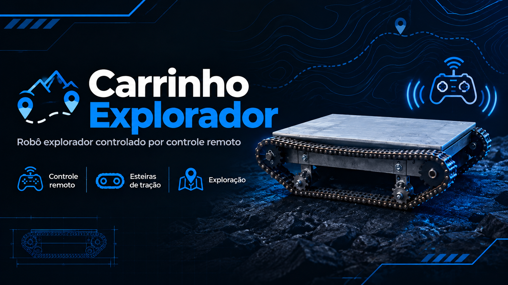

# Carrinho_Explorador

  

 
 
<h1 align="center"> Entrega - 04</h1>

##

  <a href="#requisito">Requisitos </a> 
  |
  <a href="#objetivo">Objetivo da Sprint </a>
  |
  <a href="#desenvolvimento">Desenvolvimento </a>
  |
  <a href="#cronograma">Cronograma </a>
  |
  <a href="#conclusao">Conclusão </a>
  

##

**Início: 19/11  - Fim: 28/11**

**Status da Sprint: Concluído ✅**
 
 
 

  
 ## 📜Requisitos

O projeto consiste no desenvolvimento de um carrinho explorador Roover 4x4 com controle remoto por radiofrequência (RF), utilizando componentes eletrônicos e mecânicos integrados.

  
## 📌Objetivo da Sprint
O objetivo desta fase é realizar a validação da solução. 

  
## 📚Desenvolvimento

### Introdução 
O desenvolvimento de veículos robóticos controlados remotamente permite aplicar conhecimentos de mecânica, eletrônica e programação na construção de sistemas de locomoção e controle. Nesse contexto, o projeto do carrinho explorador Roover 4x4 tem como objetivo desenvolver um veículo com tração nas quatro rodas e controle remoto por radiofrequência (RF), possibilitando comandar seus movimentos à distância. Para isso, são utilizados componentes como o Arduino Pro Mini, os módulos de comunicação NRF24L01, as pontes H BTS7960 e os motores de corrente contínua (DC). A integração desses elementos permite trabalhar com o processamento de comandos, a comunicação sem fio e o acionamento dos motores, contribuindo para o desenvolvimento de conhecimentos práticos em sistemas embarcados, eletrônica e montagem mecânica. 

### Processo 
A seguir, são descritos os principais componentes utilizados no desenvolvimento do carrinho explorador Roover 4x4. 

**• Arduino Pro Mini** 
É a placa de controle responsável pelo processamento das informações e pela execução da lógica de funcionamento do carrinho. No projeto, recebe os comandos provenientes do sistema de comunicação e coordena os sinais enviados aos módulos responsáveis pelo acionamento dos motores. 

**• Módulo de Radiofrequência NRF24L01** 
É o componente utilizado para estabelecer a comunicação sem fio entre o controle remoto e o carrinho. Ele permite transmitir e receber os comandos necessários para controlar os movimentos do veículo à distância. 

**• Ponte H BTS7960** 
É um módulo eletrônico de potência utilizado para controlar o acionamento dos motores de corrente contínua. Sua função é permitir o controle dos motores por meio dos sinais enviados pelo Arduino, de acordo com a configuração do circuito. 

**• Motores de Corrente Contínua (DC)** 
São os componentes responsáveis por gerar o movimento do carrinho. Ao receberem energia elétrica por meio do sistema de acionamento, transformam essa energia em movimento mecânico, permitindo o deslocamento do veículo. 

**• Joysticks do Controle Remoto** 
São os dispositivos utilizados pelo operador para enviar os comandos de movimentação do carrinho. Suas posições são interpretadas pelo sistema de controle, permitindo determinar os movimentos desejados e transmitir as instruções ao veículo. 

**• Estrutura Mecânica e Sistema de Transmissão** 
A estrutura mecânica é responsável por sustentar os componentes do carrinho e proporcionar a montagem do conjunto. O sistema de transmissão utiliza engrenagens e correntes para transferir o movimento mecânico, contribuindo para a locomoção do veículo com tração nas quatro rodas. 

**• Sistema de Alimentação Elétrica** 
O sistema de alimentação fornece a energia necessária para o funcionamento dos componentes eletrônicos e dos motores. Sua integração com os demais elementos é importante para o funcionamento do controle, da comunicação por radiofrequência e do sistema de locomoção. 

### Funcionamento Geral 

## Funcionamento do Sistema de Controle do Carrinho Roover 4x4 

### • Comunicação por Radiofrequência (RF) 

O sistema utiliza módulos de radiofrequência NRF24L01 para estabelecer a comunicação sem fio entre o controle remoto e o carrinho explorador Roover 4x4. Essa comunicação permite transmitir os comandos enviados pelo operador, possibilitando controlar os movimentos do veículo à distância. 

### • Envio dos Comandos 

O operador utiliza os joysticks do controle remoto para selecionar os movimentos desejados. Os comandos são processados pelo sistema eletrônico do controle e transmitidos por meio do módulo NRF24L01 ao carrinho. 

### • Recepção e Processamento dos Sinais 

O módulo NRF24L01 instalado no carrinho recebe os sinais enviados pelo controle remoto. Em seguida, o Arduino Pro Mini processa as informações recebidas e determina os comandos necessários para controlar os motores, de acordo com as instruções do operador. 

### • Acionamento dos Motores 

O carrinho utiliza motores de corrente contínua (DC) para realizar seus movimentos. Como o acionamento dos motores exige uma etapa de potência, são utilizadas pontes H BTS7960, responsáveis por controlar a alimentação dos motores conforme os sinais de comando enviados pelo Arduino. 

### • Sistema de Locomoção 

A estrutura mecânica do Roover 4x4 foi desenvolvida para permitir a movimentação do veículo por meio de seus motores e do sistema de transmissão mecânica. A combinação dos componentes mecânicos e eletrônicos permite executar os comandos de deslocamento enviados pelo controle remoto. 

### • Integração dos Sistemas 

O funcionamento do carrinho depende da integração entre a comunicação por radiofrequência, o processamento realizado pelo Arduino Pro Mini, o acionamento dos motores pelas pontes H BTS7960 e a estrutura mecânica. Esses elementos trabalham em conjunto para possibilitar o controle remoto do veículo. 

### • Resumo do Funcionamento 

O operador movimenta os joysticks do controle remoto → os comandos são transmitidos pelo módulo NRF24L01 → o módulo receptor do carrinho recebe os sinais → o Arduino Pro Mini processa os comandos → as pontes H BTS7960 controlam o acionamento dos motores DC → os motores movimentam o carrinho Roover 4x4 conforme os comandos recebidos. 

### Roteiro de Montagem 
>Para a montagem do carrinho explorador Roover 4x4, foram utilizadas ferramentas como parafusadeira, trena, chave de fenda, alicate, fita e broca escalonada. Esses instrumentos auxiliaram na fixação dos componentes, na medição das peças e na realização dos ajustes necessários à estrutura mecânica do veículo. 
Além disso, foi utilizado um multímetro para realizar medições elétricas e verificar as conexões do circuito, auxiliando na identificação de possíveis falhas nos componentes eletrônicos. O uso dessas ferramentas foi importante para a montagem e os ajustes dos sistemas mecânicos e eletrônicos do carrinho, que utiliza motores de corrente contínua, placa Arduino e módulos de controle e acionamento dos motores.  

**•	Ferramentas **

### Montagem Final

Para a montagem do carrinho foi necessário o uso de diversas ferramentas e instrumentos que garantam precisão, eficiência e segurança durante o processo de fabricação e montagem das peças. Entre as principais ferramentas utilizadas destaca-se a parafusadeira/furadeira elétrica, responsável por realizar perfurações e fixações com rapidez e qualidade. Também foi empregada a lixadeira, essencial para o corte, desbaste e acabamento de componentes metálicos, garantindo o ajuste correto das partes estruturais.
As mesas de bancada, fornecidas à mesa de trabalho, desempenharam um papel fundamental na imobilização das peças, proporcionando estabilidade durante operações de perfuração, corte e montagem. O paquímetro metálico foi utilizado para precisão de alta precisão, garantindo que os componentes apresentem as dimensões corretas para o encaixe e o alinhamento da estrutura.
Além disso, foram utilizadas chaves e brocas adequadas a diferentes tipos de parafusos e materiais usados, complementando as etapas de montagem. O pano de limpeza auxiliou na remoção de resíduos metálicos e na manutenção da organização da bancada, contribuindo para um ambiente de trabalho limpo e seguro. Por fim, uma peça metálica retangular (perfil de alumínio) serviu como base estrutural para a montagem do carrinho, conforto, leveza e estabilidade ao conjunto final.  

### Design Final

**• Conjunto Final Montado e Validado: **

## 📅Cronograma

## ✅Conclusão

Com a finalização deste projeto, foi possível desenvolver e aprimorar o carrinho Roover 4x4 com controle remoto por rádio frequência (RF), integrando conhecimentos de mecânica, eletrônica e programação. O projeto teve como objetivo construir um veículo explorador com estrutura resistente, sistema de tração eficiente e comunicação sem fio, permitindo seu controle remoto por meio de joysticks. Durante o desenvolvimento, foram realizadas etapas de pesquisa, cálculos, seleção de componentes, elaboração de desenhos técnicos, montagem da estrutura mecânica, desenvolvimento dos circuitos elétricos e programação dos microcontroladores Arduino. 
Ao longo do processo, a equipe enfrentou desafios relacionados ao custo elevado dos componentes e ao funcionamento dos sistemas eletrônicos. Entre as principais dificuldades, destacaram-se a queima do Arduino, que exigiu sua substituição, e a necessidade de trocar a ponte H, pois o componente inicialmente utilizado não atendeu às necessidades do projeto. Essas situações exigiram adaptações, novas aquisições e ajustes para dar continuidade ao desenvolvimento do carrinho. 
A colaboração entre os integrantes da equipe foi fundamental para a realização das atividades, permitindo a divisão de tarefas, a troca de conhecimentos e a busca conjunta por soluções para os problemas encontrados. Além disso, o projeto proporcionou o desenvolvimento de habilidades práticas em montagem mecânica, soldagem de componentes eletrônicos, elaboração de circuitos, programação e testes de funcionamento. 
Dessa forma, o desenvolvimento do carrinho Roover contribuiu significativamente para o aprendizado técnico e para a compreensão da integração entre diferentes áreas da tecnologia. Apesar das dificuldades encontradas durante a execução, a experiência permitiu consolidar os conhecimentos adquiridos ao longo do curso e demonstrou a importância do planejamento, da organização, da persistência e do trabalho em equipe na construção de um projeto tecnológico.

> 

#### 📝Documentação:  [Clique Aqui](https://github.com/MavPro-tech/Carrinho_Explorador/tree/sprint_04/Sprints/Sprint_04)

 

  
  ---
  

